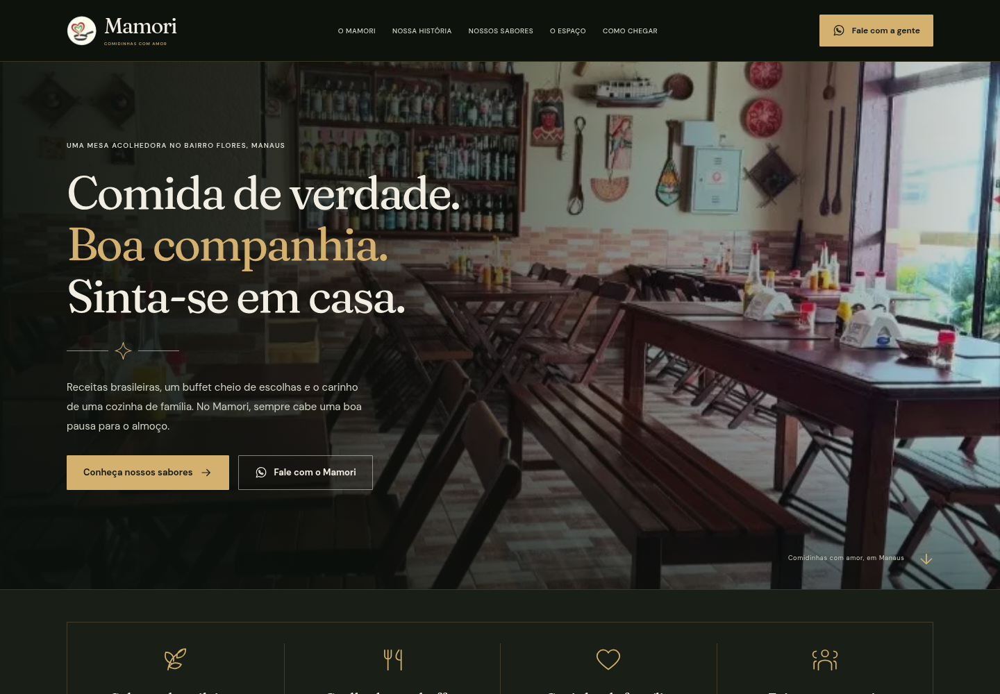

# Mamori · Comidinhas com Amor

Site do Mamori, restaurante no bairro Flores, em Manaus. Next.js App Router, React, TypeScript e Tailwind CSS, com fotos reais do material fornecido.

## Prévias do visual

Abra as imagens diretamente no GitHub, sem depender do download de arquivos pelo chat:

- [Prévia no computador](docs/previas/desktop.png)
- [Prévia no celular](docs/previas/celular.png)
- [Página completa](docs/previas/pagina-completa.jpg)
- [Demonstração do efeito de mouse](docs/previas/mouse.gif)
- [Baixar o código completo em ZIP](https://github.com/farenncinathan/site-Mamori-Restaurante/archive/refs/heads/main.zip)



As capturas mostram o design e o GIF demonstra o efeito de mouse. Para navegar e testar os botões, execute o projeto conforme as instruções abaixo. Se o repositório solicitar autenticação, entre na sua conta do GitHub para abrir as imagens e baixar o ZIP.

## Desenvolvimento

Ambiente validado com Node.js 24 e npm 11. As versões exatas das dependências estão em `package-lock.json`.

```bash
npm ci
npm run dev
```

O servidor usa a porta 3000. Para desenvolvimento na nuvem, execute `npm run dev -- --hostname 0.0.0.0`. Não são necessárias credenciais nem serviços externos para executar o site. As fontes são servidas localmente.

## Verificação e produção

```bash
npm run check  # TypeScript e build de produção
npm start     # inicia o build já gerado
```

## Testes de interface

```bash
npx playwright install chromium
npm run test:ui
```

Quando há um Chromium instalado no sistema, é possível usá-lo sem baixar outro navegador:

```bash
PLAYWRIGHT_CHROMIUM_EXECUTABLE_PATH=/usr/bin/chromium npm run test:ui
```

Por padrão, o Playwright inicia ou reutiliza o servidor de desenvolvimento. Para verificar um servidor já iniciado, inclusive o build de produção:

```bash
PLAYWRIGHT_BASE_URL=http://127.0.0.1:3000 \
PLAYWRIGHT_CHROMIUM_EXECUTABLE_PATH=/usr/bin/chromium \
npm run test:ui
```

A suíte contém 20 testes: layout e áreas de toque em 320, 360, 390, 480, 768, 1024, 1440 e 1920 px; filtros; galeria com navegação circular, teclado, gestos e retorno de foco; destinos dos links; atalho para o conteúdo; movimento reduzido; menu móvel; contato fixo; menu nativo sem JavaScript; carregamento das fotos sem erros no navegador; rastreamento e interação do cursor; mudança de preferência de movimento; e desativação do efeito em telas de toque. Testes automatizados executados em Chromium. A conferência em aparelhos físicos e Safari permanece uma verificação manual recomendada.

## Revisão de design

- Direção visual inspirada na referência enviada: fundo verde quase preto, detalhes dourados, títulos serifados e foto real do salão em toda a abertura.
- Faixa de quatro destaques, história do restaurante e cartões de pratos com bordas discretas e descrições, mantendo os dados reais do Mamori.
- Animação de mouse criada com Pointer Events, CSS e requestAnimationFrame, sem plugins ou dependências adicionais. O cursor nativo continua visível.
- O halo acompanha o ponteiro com suavidade e reage a links e botões. O efeito não intercepta eventos, não roda em telas de toque e respeita prefers-reduced-motion. O ciclo de animação para ao alcançar o ponteiro e ao sair da janela.
- Botões com áreas de toque de pelo menos 44 px, estados de foco, hover e pressão, e ajuste de tamanho nos celulares.
- Menu móvel com fechamento pelo botão, Escape, toque fora e seleção de link. O painel fecha ao mudar para desktop.
- Galeria com filtros por categoria e visualização ampliada sem recortar a imagem original, com setas, gestos horizontais e fechamento pelo fundo.
- Atalho de contato durante a rolagem no celular, oculto junto ao rodapé e quando o menu está aberto.

## Onde editar

- `src/content/business.ts`: endereço, horários, WhatsApp, Instagram e links do Maps.
- `src/content/copy.ts`: textos principais, legendas, categorias, história e referências das fotos.
- `src/components/`: apresentação e interações de cada seção.
- `src/components/CursorGlow.tsx`: comportamento do halo e do contorno do mouse; os estilos ficam em globals.css.
- `src/app/globals.css`: identidade visual, estados interativos e regras responsivas.
- `public/images/`: fotografias e logotipo originais.
- `tests/site.spec.ts`: testes de interação e responsividade.

Este repositório mantém a versão atual do Mamori: tema escuro, detalhes dourados, fotos reais do restaurante e efeito de mouse.

## Antes de colocar o site no ar

Esta entrega salva o código no repositório. O site mantém `noindex,nofollow` e o aviso demonstrativo do material original. A publicação em um domínio é uma etapa separada: configurar `metadataBase` em `src/app/layout.tsx` e conferir os dados comerciais e as imagens listados em `PENDENCIAS_CLIENTE.md`. Nenhum preço, avaliação ou serviço novo foi inventado nesta revisão.
